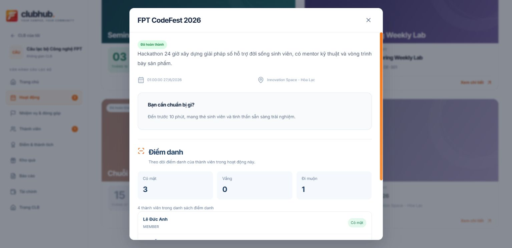
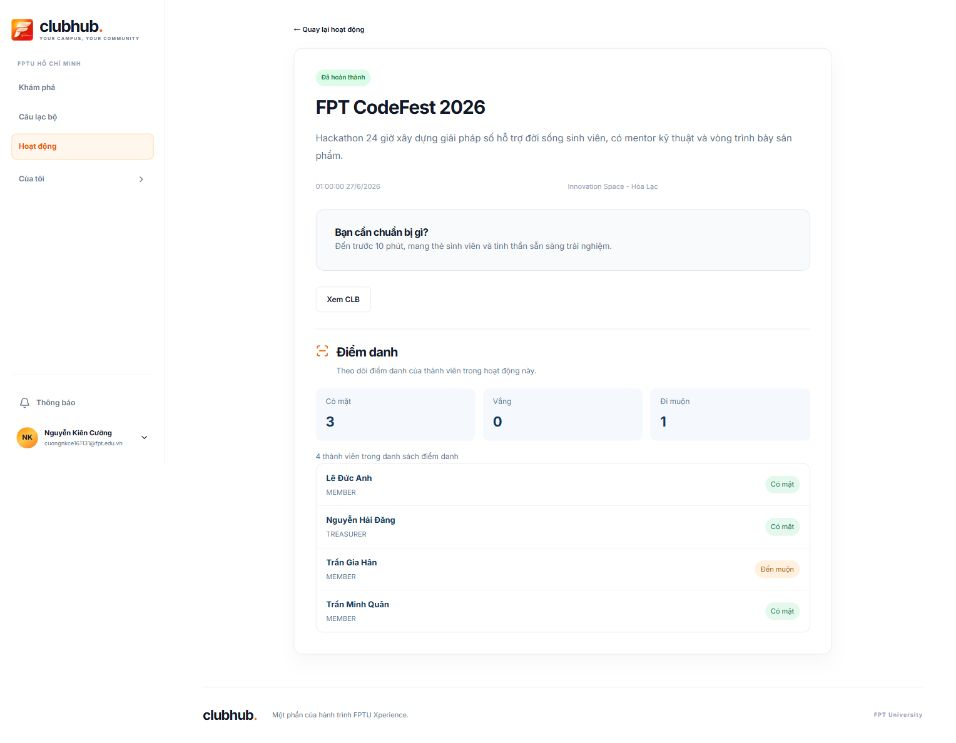

# Activity details / attendance — 2026-10-12

Historical modal layout; see [current separate public/workspace profile QA](activity-profile-ui.md). Public details now show own attendance only; workspace manager details show the club roster.

The standalone V2 workspace attendance tab and its component were removed. The old workspace `/attendance` path redirects to Activities. The legacy application outside V2 and demo navigation are unchanged.

`ActivityAttendance` is shared by the contextual activity detail modal and full detail page. It reads only the selected activity: workspace managers use the existing club activity attendance API, other viewers use their own attendance API. Full-page manager mode checks authenticated `clubAccess.isManager` for that activity's club, not a global role or location-state flag. Backend authorization remains authoritative. The migrated capability is **read-only**, matching the removed tab; this change does not add attendance writes or student check-in.

The attendance request identity includes account, club, activity, mode and page; late responses are discarded. Each page reads 20 records, with navigation based on the server total. Errors support retry and distinguish denied/expired access. No unavailable totals are fabricated as zero. Status labels use the Vietnamese locale.

Full activity details now request `GET /api/activities/{id}` rather than relying on the upcoming/live feed or navigation state. A safe display projection includes completed/cancelled activities while stripping raw participant/attendance collections. Discovery continues to include only upcoming/live activities. Wrong IDs, invalid route IDs, not-found and denied states remain separate; late previous-ID responses cannot replace the current activity.

## Verification

- `npm run test:demo`: 86/86 passed, including club-scoped manager mode, completed/cancelled detail versus feed projection, private collection stripping and late old-ID results.
- `npm run test:club-page`: passed.
- Production build passed; existing chunk-size warning remains.
- Contract documentation link/JSON check passed after replacing the deleted AttendanceTab link.
- Authenticated FPT-TECH browser: workspace navigation has no attendance tab. Opening completed FPT CodeFest showed its attendance inside the detail modal: 4 roster records, 3 present, 0 absent, 1 late. Following the detail link loaded the same completed activity and roster from the ID route. No attendance or membership records were changed.
- Member/self mode and multi-page handling are source/test checked; this session does not claim another account's live browser session or >20-row dataset validation.

