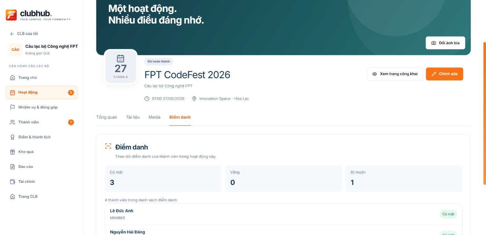
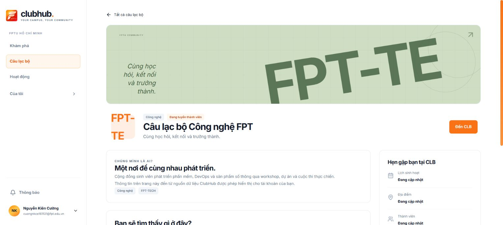
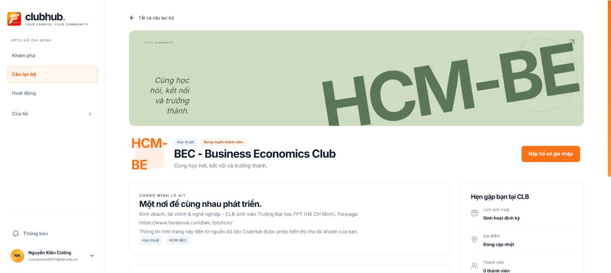

# Activity profiles and club detail CTA — 2026-10-12

## Implemented

- Public-space viewer: `/v2/activities/:activityId`, profile cover, overview, public documents/media and own attendance. It never renders management controls or the club attendance roster.
- Workspace manager: `/v2/my-clubs/:clubCode/activities/:activityId`, separate page with core editing, cover control, document/media editor and club attendance. Access is checked against the activity's club. Cards open the appropriate route directly.
- Files: PDF/DOC/DOCX/XLS/XLSX (20 MB), JPG/PNG/WebP (5 MB), MP4/WebM (100 MB). HTTPS links are supported; YouTube preview starts only after opening it. Drafts remain explicitly unsaved until server acknowledgement. Missing resource capabilities disable saving.
- Club Details puts its action at the right of the identity row. Actual club-access `isApprovedMember`/`isManager` produces `Đến CLB` with the exact encoded workspace code. A submitted application does not confer membership.

## Verification

- `npm run test:demo`: 91/91 pass; `npm run test:club-page`: pass; production build passes with the existing chunk-size warning.
- Authenticated browser: FPT-TECH manager CTA opened `/v2/my-clubs/FPT-TECH`. Public activity ID 1 has no editing/upload controls. Workspace ID 1 renders manager controls and attendance: 4 rows, 3 present, 1 late. Core edit form was opened and cancelled.
- Added a temporary CLUB-only YouTube link draft, opened its controlled youtube-nocookie preview, confirmed the disabled save boundary and discarded the draft. No backend records were changed.
- HCM-BEC outsider view renders `Nộp hồ sơ gia nhập` at the right; no application was submitted.
- Browser file selection remains unverified: the browser extension disallows local file access. Format/size validation and upload destination/acknowledgement failure cases are unit-tested. No live file upload, cover persistence, document persistence, or anonymous access is claimed.
- [Backend contract](../contracts/activity-profile-resources-api.md) records pending routes, upload security and public/private delivery. Current viewer detail is still authenticated and membership-scoped until the public BE projection is implemented.

