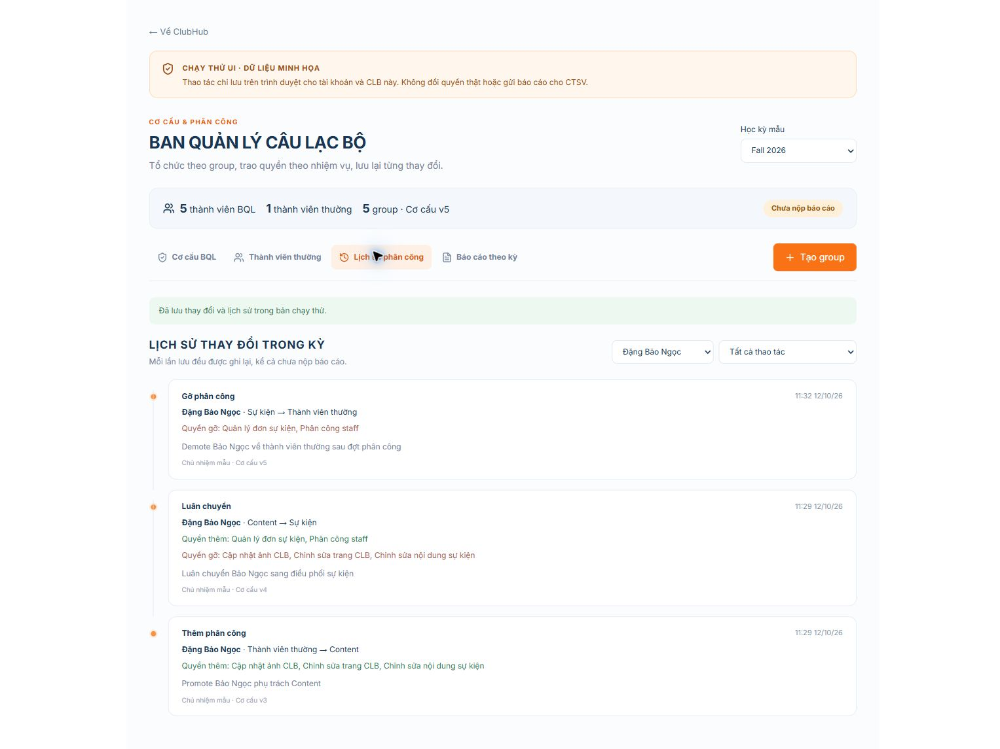
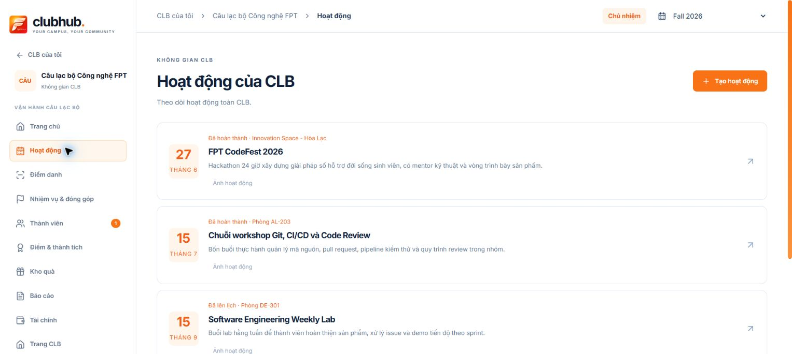

# Governance UI rehearsal — 2026-10-12

Open the running Vite app at **http://localhost:5173/v2/preview/club-governance**. Also available for authenticated managers in workspace → Thành viên CLB → `Ban quản lý`. Both entry points are DEV-only. Fixtures remain synthetic; development labels were removed at the user's request; the standalone route has no AuthProvider/API calls. Storage keys are isolated by preview namespace/account/club. Do not use fixture IDs or browser grants for live API integration.

## Verified in Chrome through computer-use

- Created `Thủ quỹ phụ`, selected the treasurer preset, unchecked finance submit, saved; card reflected only the selected financial read/draft scopes.
- Added a member to Content, transferred Content → Sự kiện, removed Event; personal timeline showed all three events, before/after groups and permission gains/losses with actor/reason/time.
- Reloaded and re-selected that person; all three events were still present.
- Submitted report #1 from structure v5; added a member to the new treasurer group while retaining Content; old report #1 still showed that treasurer group empty, exactly as captured before the later assignment.
- Pending leadership nomination and protected owner UI are separate from specialist groups; archived semester is read-only.
- Inspected desktop card layout, modal/picker and personal timeline in the browser; no live CTSV approval, role grant, report transmission or backend mutation was performed.
- Opened the existing authenticated FPT-TECH members screen, switched to the rehearsal tab and inspected its group editor inside the workspace layout. Existing membership reads rendered successfully; this observation does not verify new governance backend integration. Cancelled the editor without a live mutation.

## Automated validation

Focused data tests cover immutable history across promote/transfer/demote/report, multi-group union/removal, group permission/name impact, custom treasury limits/rollback, protected/pending leadership, archived periods, stale version and account/club isolation. Role-catalog tests check specialist responsibility matrix.

- `npm run test:demo`: 81/81 passed.
- `node --test src/pages/v2/club-workspace-page/tabs/members/club-member-roles.test.js src/pages/v2/club-workspace-page/tabs/members/governance/governance-preview-data.test.js`: 9/9 passed.
- `npm run test:club-page`: passed, including current member management and role-gated public view.
- `npm run test:demo:routes`: 18/18 existing route renders passed.
- `npm run build`: passed; existing large-chunk warning remains.
- Production JS bundle contains no rehearsal entry labels, synthetic preview identity or preview-storage namespace (verified by literal search).
- `node scripts/check-contract-docs.mjs`: 323 local links and 18 JSON examples passed.

Windows sandbox initially blocked Node/esbuild subprocesses with EPERM; checks above were rerun with permitted subprocess execution. One existing source-shape profile-route test caught incidental Prettier formatting; its original route markup was retained and the full 81-test suite passed on rerun.

## Rehearsal limits / BE handoff

Activities/attendance loading fix (2026-10-12): the dashboard request result now retains its semester scope key in loading, unavailable and ready states. Previously the scope guard rejected every completed response, leaving Activities permanently loading. Entering Activities or Attendance now invalidates the shared dashboard through the router navigation key and calls `getActivities` again; tab components continue to consume one shared source. Attendance requests its selected activity's attendance after that source is ready. Header changes and retries also reload the shared source. The existing dashboard aggregate refresh additionally reads club/report/manager-membership summaries.

Verified the actual hook with successful, failed, invalid-club, tab-navigation and semester-change requests, including a late previous-semester response: `npm run test:demo` passed 83/83; production build passed with the existing chunk-size warning. Browser navigation in authenticated FPT-TECH showed four activity cards, then an attendance activity selector and four attendance records, then Activities returned through loading to the cards. No records were changed. Activity semester filtering still requires authoritative catalog bounds; the current development catalog has none, so these screens retain all-club activities.

Layout follow-up: removed the oversized governance heading/summary and the second tab bar. Group cards are now the default view with a compact semester/history/reports/create toolbar. History and reports open independent modals; opening a report form replaces the report panel, Cancel/Close returns to it, and browser checks confirmed only one dialog at a time. Unassigned members use a collapsed disclosure below the groups; nomination actions live in protected leadership cards. Member smoke and production build passed for this layout.

Follow-up: direct role dropdown and its member-row mutation/confirmation were removed; rows now show read-only role labels. Default board groups include protected Chủ nhiệm/Phó chủ nhiệm plus Content, Event, Nhân sự, Thư ký and Thủ quỹ; empty groups are visible. Existing preview storage upgrades once, retaining assignments/history/submitted snapshots and recording newly initialized groups. MEMBER remains the ordinary-member view.

Follow-up verification: governance tests 7/7, member smoke and production build passed. Browser inspection confirmed zero comboboxes inside the member table and all seven default BQL group headings in the existing workspace preview, including empty vice/HR/secretary groups.

Six approved synthetic members and two sample periods; previous Summer example is read-only. This is not real roster paging, academic semester resolution, cross-device persistence or deployed capability verification. No approval simulation grants leader rights. Group changes apply locally on Save; report snapshots are independent. Historical runtime fixture events before later UI changes are retained, never silently rewritten.

BE implementation starts at [canonical governance contract](../contracts/club-governance-groups-api.md). Existing contracts are classified in [lifecycle audit](../contracts/contract-lifecycle-audit.md). Current facade route declarations are documented in [inventory](../contracts/api-declaration-inventory.md).

Latest follow-up: removed the ordinary/unassigned-member navigation and disclosure from BQL entirely. Member management remains at the existing top-level members screen; the group picker can still assign approved members.

Header semester follow-up: verified one semester combobox in the BQL view. Selecting Summer 2026 made governance read-only; navigating to Reports retained SU2026. Selecting Fall 2026 then opening member invitation showed Fall 2026 read-only, with zero period/year controls inside the modal. Source audit and remaining per-tab BE mappings: [workspace semester contract](../contracts/workspace-semester-context-api.md).
