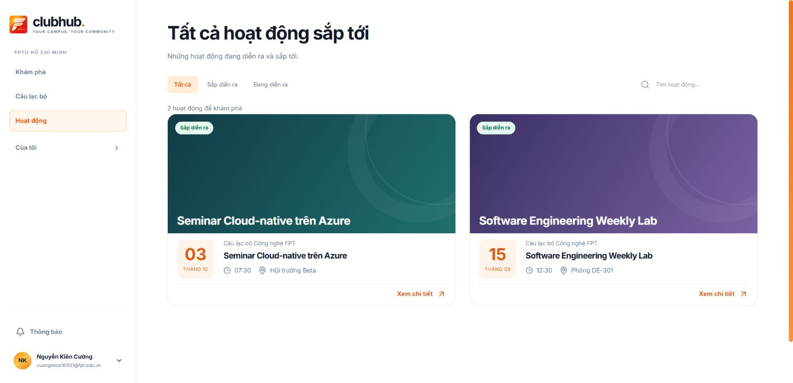
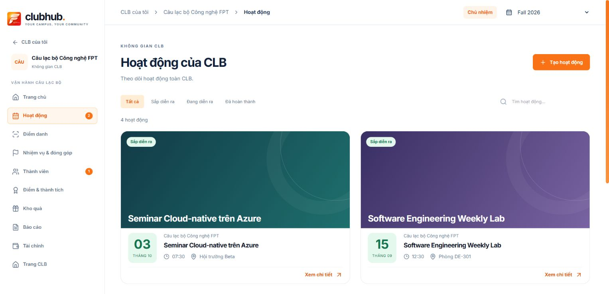
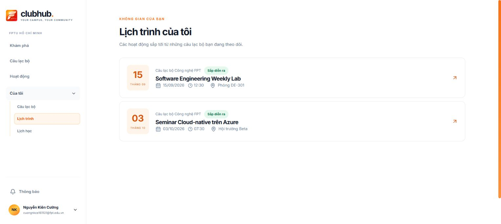
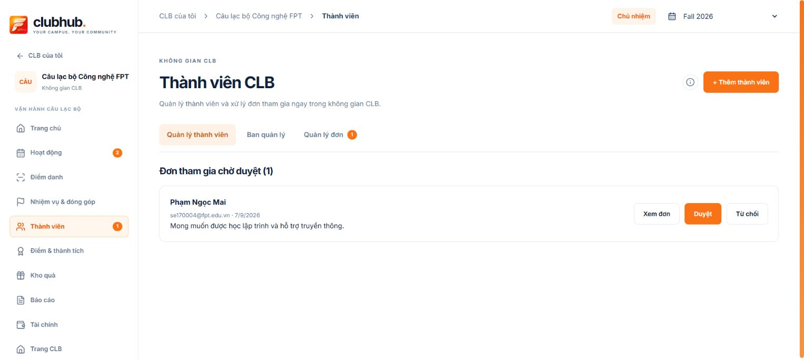

# Event cards UI — 2026-10-12

Reference: user-provided Ticketbox screenshots and [Ticketbox homepage](https://ticketbox.vn/). Adopt the poster-first event discovery hierarchy while retaining ClubHub's light/orange visual system and existing API data.

## Implemented

- Shared `ActivityCard` owns the poster, status, organizer, date/time, location, card-wide detail button and focus/hover behavior. Used by public Activities, Discover recommendations and workspace Activities.
- Desktop grid is explicitly **two cards per row**, per user correction. CSS switches to one column below 760px.
- Size follow-up: **the entire poster card has a 2:1 width/height ratio**, including cover, metadata and actions. Cover height takes the remaining space after the compact information panel; the ratio is not applied to the cover alone. Removed repeated organizer/date from fallback artwork. Personal schedule rows retain their previous layout. Browser measured public cards at 558.6 × 279.3 px (ratio 2.0); build passed.
- Use the existing `coverImageUrl` when present. Missing/failed covers render abstract CSS artwork using the real title, organizer and date; no borrowed promotional posters or invented prices, free tickets, registrations or attendee counts.
- Native buttons support keyboard activation, visible focus, Escape close and focus restoration through the existing detail modal. Motion respects reduced-motion settings. Latest follow-up removed the card cover button and its now-unreachable workspace upload dialog/state. Existing image rendering and API facade contracts remain unchanged.
- Workspace supports all/upcoming/live/completed filters and title/description/location search with result counts and clear-filter recovery. Public Activities retains its existing filters/search and gains counts and clear-filter recovery. Backend status is authoritative; dates do not silently rewrite lifecycle status.
- My Schedule retains horizontal rows with a left date tile. Add start time, clearer status/location and a detail hit target spanning the whole row. It continues to use the existing membership-filtered activity feed.
- No API signature, authorization, semester source, registration behavior or persistent state was changed.
- Sorting follow-up: public activity filters (including Discover) and workspace activity cards display descending start time. Invalid/missing dates are last; sorting does not mutate the shared feed/dashboard array or change personal schedule/attendance ordering.
- Latest member badge decision supersedes the approved-member-count follow-up: the user requested restoring **pending applications** in the manager's member navigation badge. `CountBadge` is now shared by the leftrail and the application-management tab, with the same orange background, white number, size and shape. Both use real membership API Pending records, normalizing status case; zero/unavailable counts are hidden. Approved-member totals remain in the roster/footer. Entering Members and successful membership mutations still refresh dashboard summaries.
- Calendar follow-up: poster information is a two-column row with the peach calendar tile on the **left**, a large day and month underneath, and start time below the tile. Organizer/title/location remain to its right. `Xem chi tiết` aligns to the right of the footer. Full card ratio remains 2:1; personal schedule keeps its date-led horizontal layout.

Latest ratio decision: whole poster cards now use **3:2** instead of 2:1. This supersedes the ratio references in the previous follow-ups below; two cards per row, calendar on the left, right-aligned detail action and the personal schedule row layout remain unchanged.

Latest metadata layout: start time now shares one row with location inside the right information column, rather than appearing below the calendar tile. Browser measured aligned row centers for both public cards. Personal schedule layout is unchanged.

Calendar/status colors: completed uses gray, live uses blue, upcoming uses green. Calendar tiles and status badges share the same background/text palette, including the date tiles in the personal schedule; live badge changed from orange to blue to match the requested mapping. Cancelled remains red.

Completed-card emphasis: whole completed cards use `opacity: 0.7`. The initially requested gray overlay was replaced per user correction. Detail interaction remains enabled.

## Verification

- `npm run test:demo`: 83/83 pass. Existing workspace ownership assertion now checks the shared component import instead of the retired production row class.
- `npm run test:club-page`: pass.
- `npm run build`: pass; existing large-chunk warning remains.
- Browser: public rendered two cards and workspace four cards, both with exactly two computed grid tracks at the normal desktop viewport. Workspace filter returned two upcoming cards; unmatched search returned zero and clear filters restored four. Enter opened detail, Escape closed it; manager cover action opened its own modal and was cancelled without saving. Clicking a public card and a personal schedule row opened detail.
- Desktop My Schedule remains horizontal; full room labels are visible. Screenshots below use live authorized reads; no records were changed.
- Calendar/badge follow-up verification: four workspace cards each measured ratio 2.0, calendar bounding box lies to the left of the information, and no cover-action buttons remain. Right-aligned detail action opened the selected activity modal and Escape closed it. The member navigation badge and application-management badge both showed one Pending application, matching the real list; computed badge colors matched (orange `rgb(249,115,22)`, white text) and both were 18px high. Final 83-test suite, member smoke and production build passed.
- At 390px the existing V2 shell still forces `min-width: 1060px` in `V2App.scss`, producing whole-page horizontal overflow. This is an existing shell limit and **full mobile layout is not verified as usable** by this card change. Temporary viewport override was reset. A responsive shell change requires a separate shared-navigation/layout review.

